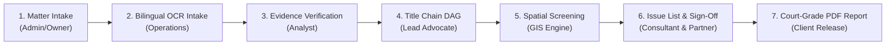
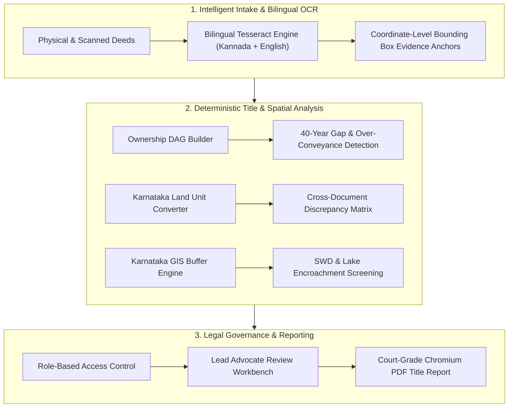

# OJIX Property Intelligence — Product Showcase & Presentation Brochures

This document contains two specialized brochures designed for specific stakeholder audiences:
1. **PART 1: The Internal Sales Playbook & Pitch Guide (For Sales & Growth Teams)**
2. **PART 2: The Enterprise Client Solution Brochure (For Law Firms, Real Estate Developers, Banks & HNW Buyers)**

---

# PART 1: Internal Sales Playbook & Product Showcase (For the Sales Team)

> **Audience:** Direct Sales Representatives, Account Executives, Solution Architects, Partner Managers  
> **Objective:** Equip the sales team with the precise product narrative, market wedge, buyer personas, competitive defensibility, objection-handling, and feature walk-throughs based on our running platform.

---

### 1. The Core Elevator Pitch (30-Second Hook)

> *"Bengaluru’s property market suffers from 40% litigation risk due to broken 40-year deed chains, Kannada-English revenue document contradictions, and sudden NGT lake or Rajakaluve drain buffer demolitions. **OJIX Property Intelligence** is an automated, evidence-first due diligence platform that ingests physical land records, bilingual scans, and RTCs, reconstructs 40-year title ownership DAGs, screens GIS buffers instantly, and outputs legal-grade due-diligence opinions signed off by qualified advocates in under 24 hours instead of 3 weeks."*

---

### 2. Market Pain & The Value Equation

| The Traditional Way (Without OJIX) | The OJIX Advantage (What We Developed) |
|---|---|
| **Manual Paralegal Reading:** 15–25 days spent sifting through 100+ pages of handwritten Kannada RTCs and brittle Sale Deeds. | **Automated Bilingual OCR:** Tesseract engine (`kan+eng`) extracting survey numbers, boundaries, parties, and extents with coordinate bounding-box anchors. |
| **Silent Title Gaps:** Missing ancestral link deeds or fraudulent over-conveyance missed during manual scanning. | **Deterministic Ownership DAG:** Algorithms reconstruct 40-year transaction graphs, instantly spotting chronological inversions, missing link deeds, and over-conveyance. |
| **Blind Spatial Violations:** Buyers only discover Rajakaluve or lake buffer zones when BBMP/BDA issues demolition notices. | **Statutory GIS Screening:** Direct overlay against Karnataka GIS & Master Plan layers for 50m/25m/15m SWD buffers and 30m lake periphery zones. |
| **Scattered WhatsApp/Email Handoffs:** Documents lost in email threads; lack of audit trail. | **8-Role Controlled Workflow:** Clean separation of duties between Operations, Analysts, Reviewing Advocates, Consultants, and Partners. |
| **Unformatted Opinion Drafts:** Inconsistent Word documents with disclaimers prone to human error. | **Headless Chromium PDF Generation:** Court-grade multi-page legal opinions with firm branding, running headers, discrepancy tables, and cryptographic checksums. |

---

### 3. Key Buyer Personas & Pitch Angles

#### A. Law Firms & Independent Real Estate Advocates
* **Pain Point:** Overburdened associates spending 80% of their billing hours on manual verification and transcription rather than high-value advisory.
* **Our Pitch:** *"Scale your title practice $5\times$ without adding headcount. OJIX acts as an automated junior associate that extracts facts, prepares side-by-side evidence, and flags discrepancy matrices, leaving your advocates solely focused on certifying legal opinions."*

#### B. Tier-1 Real Estate Developers & Land Aggregators
* **Pain Point:** Paying non-refundable token advances on parcels that later turn out to have unreleased bank charges or NGT buffer encumbrances.
* **Our Pitch:** *"Run pre-acquisition rapid screening within hours. Verify 30-year unbroken title, Rajakaluve buffer distances, and land conversion orders before depositing earnest money."*

#### C. Housing Finance Companies & Private Credit Funds
* **Pain Point:** Non-performing collateral due to forged link deeds or khata discrepancies between revenue and municipal bodies.
* **Our Pitch:** *"Institutional title risk scoring (0–100 ceiling) with immutable snapshot archives for audit committee compliance."*

---

### 4. Live Platform Capabilities Checklist (What You Can Demo Right Now!)

When demonstrating the application to prospective buyers, navigate through these proven live modules:



1. **Instant One-Click Demo Mode (`apps/api` & `apps/web`):**
   * Demonstrate instant access without database dependency or delayed email OTPs.
   * Switch live between all **10 Roles** (`Owner`, `Admin`, `Lawyer`, `Analyst`, `Operations`, `Consultant`, `Support`, `Data Steward`, `Super Admin`, `Viewer`).
2. **Matter Workspace & Multi-Property Lifecycle (FRD §5 / §7):**
   * Top-level client matter dossiers (`OJIX-M-2026-XXX`) grouping multiple property parcels under a single engagement.
3. **Bilingual OCR & Side-by-Side Document Review:**
   * Showcase Sale Deeds, RTC Pahani, Mutation Extracts, and ECs with hoverable bounding boxes in normalized coordinates.
   * Field confidence scoring with manual overrides and audit trails.
4. **40-Year Title Chain DAG & Gap Detection:**
   * Visual chronological tree displaying acquisition, partition, gift, and sale events.
   * Automatic alert badges: `TITLE_GAP_MISSING_PREDECESSOR`, `CHRONOLOGICAL_INVERSION`, and `EXTENT_OVERCONVEYANCE`.
5. **Karnataka Spatial Rules Engine:**
   * Automated buffer distance checks: Primary Drain ($50\text{ m}$), Secondary Drain ($25\text{ m}$), Tertiary Drain ($15\text{ m}$), and Lake Periphery ($30\text{ m}$).
6. **Discrepancy Matrix & Unit Normalizer:**
   * Native handling of Karnataka land units: Acres, Guntas, Cents, Ankanas, Sq Ft, and Sq Yards.
7. **Legal-Grade Headless Chromium Report Exporter:**
   * Instant binary generation of multi-page title search reports with watermarks, firm letterheads, page numbering (*"Page X of Y"*), and advocate signature blocks.

---

### 5. Sales Handling for Common Objections

* **Objection:** *"Does your AI replace our lawyers?"*  
  * **Answer:** *"No. OJIX strictly enforces the Separation of Powers. Our software is an evidence synthesis engine. By design, the platform prevents automated self-certification and mandates that a qualified Lead Advocate review the evidence and issue the final title certification."*
* **Objection:** *"Is our client's land data safe?"*  
  * **Answer:** *"We use strict tenant isolation, SHA-256 cryptographic file checksumming, role-based access control (RBAC), and stateless session sandboxing. Client documents are never pooled or used to train third-party public models."*
* **Objection:** *"Can this read old Kannada documents?"*  
  * **Answer:** *"Yes. We built a specialized bilingual engine (`kan+eng`) fine-tuned for Karnataka revenue vocabulary (Pahani, Saguvali Chit, M.R. extracts, Tippan, and Aakarbandh)."*

---

# PART 2: Client-Facing Solution Brochure (For Prospective Clients & Partners)

> **Audience:** Managing Partners of Law Firms, In-House Legal Counsels, Developers, Chief Risk Officers  
> **Tone:** Authoritative, Professional, Institutional, Tech-Forward, Compliance-Focused

---

# OJIX Property Intelligence
### *Next-Generation Real Estate Due Diligence & Title Intelligence Platform*

```
════════════════════════════════════════════════════════════════════════════════════
  BENGALURU  │  MYSURU  │  RAMANAGARA  │  MANGALURU  │  TUMAKURU  │  MANDYA
════════════════════════════════════════════════════════════════════════════════════
```

---

## Executive Overview

Acquiring and financing real estate in Karnataka requires navigating complex, multi-decade documentation fragmented across manual Sub-Registrar records, bilingual revenue forms, municipal bodies (BBMP / BDA), and evolving environmental buffer mandates.

**OJIX Property Intelligence** is an enterprise-grade legal technology platform engineered specifically for Karnataka land transactions. By unifying bilingual optical character recognition, title graph reconstruction algorithms, and cadastral spatial screening, OJIX compresses traditional 3-week due-diligence cycles into hours while eliminating hidden title and buffer risks.

---

## Core Product Capabilities



### 1. Bilingual Document Intake & Evidence Anchoring
* **Karnataka Revenue Corpus Support:** Native support for Sale Deeds, RTC (Pahani), Mutation Registers (M.R.), Encumbrance Certificates (EC Form 15/16), e-Khata, Conversion Orders (Section 95), and Tax Receipts.
* **Bilingual Kannada-English OCR:** Ingests degraded physical and digital records with token-level bounding boxes linking every extracted party name, survey number, and schedule boundary directly to its source page coordinates.
* **Side-by-Side Review Workbench:** Analysts can compare extracted fields against raw scans with single-click manual correction overrides.

### 2. 40-Year Title Chain Reconstruction & DAG Engine
* **Ownership Graph Synthesizer:** Reconstructs the unbroken flow of title over a 30- to 40-year period, automatically structuring partition deeds, gift conveyances, sale transactions, and inheritance mutations.
* **Algorithmic Defect Identification:**
  * **Chain Break Alert:** Identifies periods lacking registered link deeds.
  * **Extent Over-Conveyance:** Detects when a vendor purports to convey more extent than acquired in prior parent deeds.
  * **Chronological Inversions:** Flags deeds executed prior to seller’s legal acquisition date.
  * **South Indian Alias Normalization:** Resolves variant spellings and patronymic initials across decades.

### 3. Statutory Spatial & Environmental Buffer Screening
* **Karnataka GIS Integration:** Direct alignment with BDA Revised Master Plan and Revenue Survey maps.
* **Automated Waterbody Buffers:**
  * **Primary Rajakaluve (Storm Water Drain):** $50\text{ m}$ statutory buffer.
  * **Secondary Drain:** $25\text{ m}$ buffer.
  * **Tertiary Drain:** $15\text{ m}$ buffer.
  * **Lake / Waterbody Periphery:** $30\text{ m}$ NGT environmental buffer.
* **Encroachment Severity Alerts:** Categorizes property coordinates as *Clear*, *Buffer Zone Warning*, or *Encroached*.

### 4. Cross-Document Discrepancy Engine
* **Multi-Source Schedule Reconciler:** Compares land extent and boundary descriptions (North, South, East, West) across Sale Deeds, RTC Column 3, Survey Tippan, and e-Khata certificates.
* **Karnataka Unit Normalization:** Seamless conversion across Acres, Guntas, Sq Ft, Sq Yards, Cents, and Ankanas.
* **Explainable Risk Scoring:** Computes an objective risk score ($0\text{ to }100$ ceiling) with categorized critical, high, and medium severity findings.

### 5. Multi-Property Matter Lifecycle Management
* **Matter Folders:** Organizes client engagements into consolidated dossiers (`OJIX-M-2026-XXX`) containing multiple constituent survey parcels.
* **Multi-Discipline Role Workspaces:** Dedicated views and permission fences for:
  * **Managing Partners / Owners:** Governance, team allocation, firm settings, and release approval.
  * **Lead Advocates:** Legal opinion drafting, dispute adjudication, and statutory sign-off.
  * **Evidence Analysts:** Fact verification, boundary inspection, and task tracking.
  * **Operations:** Intake processing and queue management.
  * **Clients / Viewers:** Read-only portal for completed and approved matters.

### 6. Legal-Grade Report Generation
* **Court-Ready PDF Output:** Generated via headless Chromium, featuring:
  * Custom Law Firm / Institutional Letterhead Branding.
  * Tabular 40-Year Chain-of-Title Flowchart.
  * Comprehensive Discrepancy & Finding Registers.
  * GIS Screening Map Snapshots.
  * High-Resolution Itemized Evidence Appendix.
  * Running headers, page counts (*"Page X of Y"*), and statutory legal disclaimers.

---

## Technical Architecture & Security Posture

```
┌────────────────────────────────────────────────────────────────────────┐
│                        WEB PORTAL (React 18 + Vite)                    │
│      10-Role RBAC · MapLibre GIS · Side-by-Side Verification           │
└───────────────────────────────────┬────────────────────────────────────┘
                                    │ HTTPS / REST API
┌───────────────────────────────────▼────────────────────────────────────┐
│                       BACKEND API (Node.js + Express)                  │
│    Zod Schemas · Title DAG · Buffer Engine · Discrepancy Normalizer    │
└──────────┬────────────────────────┬─────────────────────────┬──────────┘
           │                        │                         │
┌──────────▼──────────┐  ┌──────────▼──────────┐   ┌──────────▼──────────┐
│  BILINGUAL OCR      │  │  STORAGE & DB       │   │  REPORT RENDERING   │
│  Tesseract Engine   │  │  MariaDB / Cloud SQL│   │  Headless Chromium  │
│  Kannada + English  │  │  Stateless Sandbox  │   │  Legal PDF Engine   │
└─────────────────────┘  └─────────────────────┘   └─────────────────────┘
```

* **Zero-Knowledge Multi-Tenancy:** Strict data isolation per organization.
* **Cryptographic Provenance:** Every uploaded file is stamped with SHA-256 hashes for chain-of-custody verification.
* **Protected Sole Owner Invariant:** Governance rules guarantee no organization can ever be orphaned or left without accountable ownership.
* **Separation of Duties:** Administrative owners cannot self-certify title search opinions without Lead Advocate verification, protecting malpractice insurance compliance.

---

## The OJIX Difference

| Metric | Traditional Practice | With OJIX Property Intelligence |
|---|---|---|
| **Turnaround Time per Title Search** | 14 – 21 Days | **24 – 48 Hours** |
| **Bilingual Land Record Intake** | Manual transcription | **Automated OCR with Coordinate Anchoring** |
| **Rajakaluve / Lake Encroachment Check** | Physical site visit & surveyor liaison | **Instant GIS Spatial Buffer Screening** |
| **Auditability & Institutional Compliance** | Unstructured paper files | **Immutable Digital Snapshot & SHA-256 Log** |
| **Report Consistency** | Fragmented word processor templates | **Standardized Court-Grade Headless PDF** |

---

## Schedule a Private Demonstration

To experience a live walk-through with synthetic Karnataka property dossiers (Whitefield, Jayanagar, Hebbal, Mysuru, Ramanagara, Mangaluru):

* **Platform Website:** `https://ojix.in`
* **Enterprise Inquiries:** `enterprise@ojix.in`
* **Office Address:** Ranga Rao Road, Shankarapura, Bengaluru, Karnataka 560004
